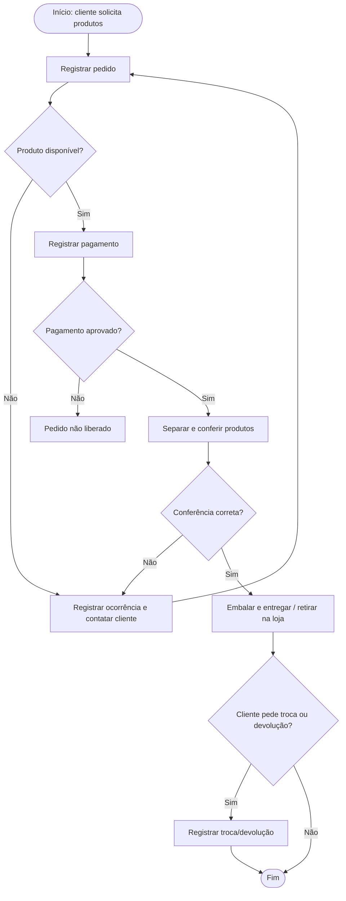
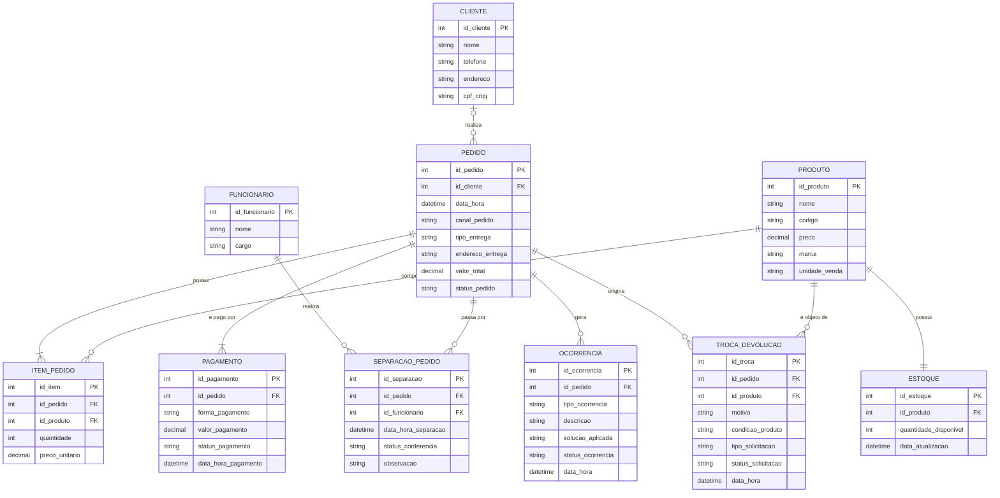

# Modelagem de Banco de Dados para a Catel HLM, loja de materiais de construção

## Integrantes

| Nome | RGM |
|----|----|
| Benjamim Osmar | 47352663 |
| Carlos Daniel | 42869234 |
| Guilherme Enzo | 47356481 |
| Erick Jaldin | 47364891 |

**Entrega 1 — Modelo Conceitual (DER)**

---

## Introdução

A Catel HLM (Hidráulica, Louças e Metais) é uma loja de materiais de construção localizada na Vila Ré, em São Paulo/SP, que vende por atendimento presencial, WhatsApp e outros canais de venda. Na entrevista com a operação, observamos que o controle de estoque depende de acompanhamento manual e que problemas como produto errado ou falta de estoque são resolvidos caso a caso, sem registro estruturado do motivo e da solução.

**Objetivo geral:** elaborar o modelo conceitual (DER) de um sistema de gestão de informações para a Catel HLM.

**Objetivos específicos:**

- levantar processos, requisitos e regras de negócio por meio de pesquisa de campo;
- identificar entidades, atributos, relacionamentos e cardinalidades;
- documentar e justificar as decisões de modelagem.

**Delimitação:** o modelo cobre cadastro de clientes, funcionários e produtos, pedidos, pagamentos, saldo de estoque, separação/conferência, ocorrências e trocas/devoluções. Ficam fora desta etapa o cadastro de fornecedores e o histórico de movimentação (entradas e saídas) de estoque: nesta primeira entrega, o estoque é modelado como saldo atual por produto, que foi o que a entrevista mostrou ser consultado no momento do pedido. Esses itens ficam como trabalho futuro. O dicionário de dados em HTML traz, em caráter preliminar, tipos de dado e índices sugeridos; o modelo lógico/físico completo e a implementação não fazem parte desta entrega.

---

## Desenvolvimento

## 1. Caracterização da Organização

### Nome e natureza da organização

**Catel HLM** (nome fantasia; HLM refere-se a Hidráulica, Louças e Metais), com mais de 40 anos de atuação no mercado, segundo o perfil no AECweb (o CNPJ atual foi aberto em 2004), no comércio varejista de materiais de construção: hidráulica, louças, metais, acabamentos, materiais básicos, portas e janelas, pisos, azulejos, pias e gabinetes, com fabricação própria de calhas e rufos. A venda ocorre em loja física e por canais remotos, como WhatsApp.

- **Razão social:** Catel - Hidráulicos, Louças e Metais Ltda
- **Nome fantasia:** Catel HLM
- **Natureza jurídica:** Sociedade Empresária Limitada
- **CNPJ (matriz):** 06.969.238/0001-06, aberto em 18/08/2004 (consulta pública em `[URL e data da consulta]`)
- **Filial:** CNPJ 06.969.238/0002-97, Rua São Severo, 800 - Vila Ré, São Paulo - SP (ativa). A unidade analisada neste trabalho é a matriz. `[confirmar se o escopo fica só na matriz]`
- **Site:** https://catelhlm.com.br/ `[conferir se está no ar e se o rodapé confirma razão social e CNPJ]`
- **CNAE:** 4744-0/99 (comércio varejista de materiais de construção em geral)
- **Telefone:** (11) 2023-9922
- **Endereço da matriz (unidade analisada):** R. Itinguçu, 2190 - Vila Ré, São Paulo - SP, 03658-001
- **Responsável entrevistado:** `[nome e função]`

### Contexto e porte

Organização com fins lucrativos, com matriz e uma filial; o estudo cobre a matriz, que atende de três formas:

- **Loja física:** o cliente compra diretamente no balcão.
- **WhatsApp:** o cliente envia produtos e quantidades por mensagem.
- **Outros canais de venda:** pedidos recebidos por outros canais da empresa, incluindo o site/e-commerce `[confirmar na entrevista como funcionam pagamento e entrega nesse canal]`.

Após o registro, os produtos são separados no estoque, conferidos e, quando necessário, embalados para entrega. `[número de funcionários e volume aproximado de pedidos, se informado na entrevista]`

### Problemas e necessidades identificados

O controle de estoque depende do acompanhamento manual das entradas e saídas. Ao receber um pedido, a equipe precisa verificar a quantidade disponível no sistema e, em alguns casos, conferir fisicamente no estoque.

Problemas como produto errado, falta de estoque ou falha na entrega são tratados caso a caso, por contato direto com o cliente, sem registro estruturado do motivo e da solução aplicada.

O projeto busca estruturar os dados de produtos, pedidos, pagamentos, estoque, separação/conferência, ocorrências e trocas/devoluções, facilitando o controle da operação e futuras análises gerenciais.

### Justificativa da escolha

A loja foi escolhida por apresentar uma operação comercial real, com múltiplos canais de venda, controle de estoque, conferência de pedidos antes da entrega e tratamento de problemas pós-venda. Isso oferece processos suficientes para a modelagem sem ser complexa demais para esta etapa do curso. `[acrescentar o motivo do acesso: como o grupo chegou até a loja]`

### Evidências da organização

- endereço confirmado no Google Maps: `[link]`;
- telefone de contato: (11) 2023-9922;
- perfil de fornecedor no portal AECweb: `[link]`;
- consulta pública do CNPJ 06.969.238/0001-06, que confirma razão social, atividade (CNAE 4744-0/99), data de abertura, endereço da matriz e existência da filial: `[URL e data da consulta]`;
- site da empresa: https://catelhlm.com.br/ `[conferir]`;
- avaliação de clientes no Google: 4,3★, com mais de 1.100 avaliações, consultada em `[data]`;
- entrevista com a operação da loja sobre cadastro de produtos, pedidos, estoque, pagamento, separação e trocas/devoluções, realizada em `[data]`;
- fotos da visita: `[anexar imagens na pasta /evidencias e linkar aqui]`.

---

## 2. Processos de Negócio

### Principais processos mapeados

| Processo | Descrição |
|---|---|
| Cadastro de produtos | Registro de nome, preço e código, além de marca e unidade de venda quando aplicável. |
| Realização do pedido | O cliente compra na loja ou pede por WhatsApp/canais de venda. |
| Registro do pedido | Registro dos produtos, quantidades, valor, forma de pagamento e, quando há entrega, dados do cliente e endereço. |
| Controle de estoque | Verificação da disponibilidade do produto no momento do pedido, com conferência física quando necessário. |
| Confirmação de pagamento | Após a aprovação do pagamento, o pedido é liberado para separação. |
| Separação e conferência | O funcionário retira os produtos do estoque, confere quantidade e correspondência com o pedido e embala os itens. |
| Tratamento de problemas | Contato com o cliente em caso de produto errado, falta de estoque ou problema na entrega, com substituição, correção do pedido ou nova entrega. |
| Troca ou devolução | Verificação do motivo e da condição do produto, seguindo o procedimento da empresa. |

### Fluxograma

Fluxo principal (versão em Mermaid; a imagem final do fluxograma deve ser anexada em `/evidencias/fluxograma.png`):

| Elemento | Significado |
|---|---|
| Retângulo arredondado | Início / Fim |
| Retângulo | Processo / Atividade |
| Losango | Decisão |
| Setas | Fluxo de execução |

---

## 3. Requisitos do Sistema

### 3.1 Requisitos Funcionais

| Requisito | Entidade e associação |
|---|---|
| O sistema deve permitir cadastrar clientes. | CLIENTE — associado a PEDIDO. |
| O sistema deve permitir cadastrar funcionários. | FUNCIONARIO — associado a SEPARACAO_PEDIDO. |
| O sistema deve permitir cadastrar produtos com nome, preço e código. | PRODUTO — associado a ESTOQUE, ITEM_PEDIDO e TROCA_DEVOLUCAO. |
| O sistema deve permitir registrar marca e unidade de venda quando aplicável. | PRODUTO — atributos opcionais marca e unidade_venda. |
| O sistema deve permitir registrar a quantidade disponível de cada produto. | ESTOQUE — associado a PRODUTO. |
| O sistema deve permitir registrar pedidos feitos na loja, por WhatsApp ou por outros canais. | PEDIDO — atributo canal_pedido. |
| O sistema deve permitir registrar os produtos e quantidades de cada pedido. | ITEM_PEDIDO — associa PEDIDO e PRODUTO, com quantidade e preço unitário. |
| O sistema deve permitir registrar forma de pagamento, valor e status do pagamento. | PAGAMENTO — associado a PEDIDO. |
| O sistema deve liberar o pedido para separação somente após a confirmação do pagamento. | PEDIDO (status_pedido) e PAGAMENTO (status_pagamento). |
| O sistema deve registrar dados do cliente e endereço quando o pedido for para entrega. | PEDIDO — tipo_entrega e endereco_entrega; associado a CLIENTE. |
| O sistema deve permitir consultar a quantidade disponível de cada produto. | ESTOQUE. |
| O sistema deve registrar a separação e conferência dos produtos antes da entrega. | SEPARACAO_PEDIDO — associado a PEDIDO e FUNCIONARIO. |
| O sistema deve registrar ocorrências como produto errado, falta de estoque ou problema na entrega. | OCORRENCIA — associada a PEDIDO. |
| O sistema deve registrar solicitações de troca, devolução ou reembolso. | TROCA_DEVOLUCAO — associado a PEDIDO e PRODUTO. |
| O sistema deve permitir consultar pedidos, pagamentos e status de entrega. | PEDIDO e PAGAMENTO. |

### 3.2 Requisitos Não Funcionais

| Requisito | Descrição |
|---|---|
| Usabilidade | As informações devem ser apresentadas de forma clara e organizada. |
| Integridade | Os relacionamentos entre pedidos, produtos, pagamentos, estoque e ocorrências devem permanecer consistentes. |
| Segurança | Dados de clientes (endereço, contato) e informações financeiras devem ter controle de acesso adequado. |
| Desempenho | Consultas de estoque e status de pedido devem ter resposta rápida, pois impactam diretamente a venda. |
| Disponibilidade | O estoque deve ser atualizado para refletir corretamente a disponibilidade em todos os canais. |
| Escalabilidade | O modelo deve permitir o crescimento de produtos, pedidos, canais de venda e funcionários. |
| Rastreabilidade | O sistema deve manter o histórico de ocorrências e trocas/devoluções de cada pedido. |

---

## 4. Regras de Negócio

### 4.1 Regras Operacionais

| Regra |
|---|
| Todo produto deve possuir nome, preço e código cadastrados; a quantidade disponível é controlada na entidade ESTOQUE. |
| Marca e unidade de venda são opcionais, conforme o tipo de item. |
| Todo pedido deve possuir identificador único e pelo menos um item. |
| A quantidade de um item de pedido deve ser maior que zero. |
| Cada item de pedido deve estar associado a um produto cadastrado. |
| O preço unitário do item deve representar o valor praticado no momento da venda. |
| Todo pedido deve identificar o canal de origem: LOJA, WHATSAPP ou CANAL_VENDA. |
| Quando o pedido for para entrega, os dados do cliente e o endereço são obrigatórios. |
| A disponibilidade do produto deve ser verificada no estoque no momento do pedido. |
| A quantidade disponível em estoque não pode ser negativa. |
| O pedido só é liberado para separação após a confirmação do pagamento. |
| Pagamentos recusados não liberam o pedido para separação. |
| Todo item separado deve ser conferido quanto à quantidade e à correspondência com o pedido antes do envio. |
| Toda ocorrência deve ser registrada com tipo, descrição e solução aplicada. |
| Toda solicitação de troca ou devolução deve registrar motivo e condição do produto. |
| A solução de troca/devolução (substituição, devolução, reembolso) segue o procedimento definido pela empresa. |

### 4.2 Restrições Organizacionais

| Restrição | Impacto no modelo |
|---|---|
| O estoque é controlado por produto, com verificação manual quando necessário. | Cada produto tem um registro em ESTOQUE; a conferência física faz parte de SEPARACAO_PEDIDO. |
| Pedidos chegam por canais diferentes. | O modelo usa o atributo canal_pedido em vez de uma entidade por canal. |
| Nem todo pedido tem entrega. | Os atributos de entrega em PEDIDO são condicionais a tipo_entrega. |
| Problemas são resolvidos caso a caso pela equipe. | A entidade OCORRENCIA registra tipo, descrição e solução. |
| Trocas e devoluções seguem procedimento próprio. | TROCA_DEVOLUCAO é separada de OCORRENCIA, pois trata da pós-venda de um produto já recebido. |

---

## 5. Dicionário de Dados Conceitual (Preliminar)

Os exemplos de valores citados são fictícios; nenhum dado real de clientes ou funcionários foi utilizado.

### 5.1 CLIENTE

| Atributo | Descrição | Regra de negócio associada |
|---|---|---|
| id_cliente | Identificador único do cliente | Obrigatório e único (PK) |
| nome | Nome do cliente | Obrigatório quando há entrega |
| telefone | Telefone/WhatsApp de contato | Obrigatório quando há entrega |
| endereco | Endereço do cliente | Obrigatório quando tipo_entrega = ENTREGA |
| cpf_cnpj | CPF ou CNPJ informado | Opcional; se informado, deve ser único |

### 5.2 FUNCIONARIO

| Atributo | Descrição | Regra de negócio associada |
|---|---|---|
| id_funcionario | Identificador único do funcionário | Obrigatório e único (PK) |
| nome | Nome do funcionário | Obrigatório |
| cargo | Função exercida | Obrigatório |

### 5.3 PRODUTO

| Atributo | Descrição | Regra de negócio associada |
|---|---|---|
| id_produto | Identificador único do produto | Obrigatório e único (PK) |
| nome | Nome do produto | Obrigatório |
| codigo | Código do produto (SKU/código de barras) | Obrigatório e único |
| preco | Preço atual de venda | Obrigatório; maior que zero |
| marca | Marca do produto | Opcional; depende do tipo de produto |
| unidade_venda | Unidade de venda (unidade, m², metro, saco, kg) | Opcional; depende do tipo de produto |

### 5.4 ESTOQUE

| Atributo | Descrição | Regra de negócio associada |
|---|---|---|
| id_estoque | Identificador único do registro de estoque | Obrigatório e único (PK) |
| id_produto | Produto controlado | Obrigatório e único (FK) |
| quantidade_disponivel | Quantidade disponível | Obrigatório; maior ou igual a zero |
| data_atualizacao | Data e hora da última atualização | Obrigatório |

### 5.5 PEDIDO

| Atributo | Descrição | Regra de negócio associada |
|---|---|---|
| id_pedido | Identificador único do pedido | Obrigatório e único (PK) |
| id_cliente | Cliente do pedido | Opcional (FK); obrigatório quando há entrega |
| data_hora | Data e horário do registro | Obrigatório |
| canal_pedido | Canal utilizado | Obrigatório: LOJA, WHATSAPP ou CANAL_VENDA |
| tipo_entrega | Retirada na loja ou entrega | Obrigatório: RETIRADA ou ENTREGA |
| endereco_entrega | Endereço de entrega | Obrigatório quando tipo_entrega = ENTREGA |
| valor_total | Valor total do pedido | Obrigatório; calculado a partir dos itens |
| status_pedido | Situação no fluxo (registrado, pago, em separação, conferido, enviado, entregue, com ocorrência, cancelado) | Obrigatório |

### 5.6 ITEM_PEDIDO

| Atributo | Descrição | Regra de negócio associada |
|---|---|---|
| id_item | Identificador único do item | Obrigatório e único (PK) |
| id_pedido | Pedido do item | Obrigatório (FK) |
| id_produto | Produto do item | Obrigatório (FK) |
| quantidade | Quantidade vendida | Obrigatório; maior que zero |
| preco_unitario | Preço no momento da venda | Obrigatório; preserva o histórico |

### 5.7 PAGAMENTO

| Atributo | Descrição | Regra de negócio associada |
|---|---|---|
| id_pagamento | Identificador único do pagamento | Obrigatório e único (PK) |
| id_pedido | Pedido pago | Obrigatório (FK) |
| forma_pagamento | Forma utilizada | Obrigatório: PIX, Crédito, Débito ou Dinheiro |
| valor_pagamento | Valor do pagamento | Obrigatório; maior que zero |
| status_pagamento | Situação do pagamento | Obrigatório: Aprovado, Recusado ou Pendente |
| data_hora_pagamento | Data e horário do pagamento | Obrigatório |

### 5.8 SEPARACAO_PEDIDO

| Atributo | Descrição | Regra de negócio associada |
|---|---|---|
| id_separacao | Identificador único da separação | Obrigatório e único (PK) |
| id_pedido | Pedido separado | Obrigatório (FK) |
| id_funcionario | Funcionário responsável | Obrigatório (FK) |
| data_hora_separacao | Data e horário da separação | Obrigatório |
| status_conferencia | Resultado da conferência | Obrigatório: Conferido ou Divergente |
| observacao | Observações da conferência | Opcional |

### 5.9 OCORRENCIA

| Atributo | Descrição | Regra de negócio associada |
|---|---|---|
| id_ocorrencia | Identificador único da ocorrência | Obrigatório e único (PK) |
| id_pedido | Pedido relacionado | Obrigatório (FK) |
| tipo_ocorrencia | Tipo do problema | Obrigatório: Produto Errado, Falta de Estoque, Problema na Entrega ou Outro |
| descricao | Descrição do problema | Obrigatório |
| solucao_aplicada | Resolução dada | Obrigatório: Substituição, Correção do Pedido, Nova Entrega ou Outro |
| status_ocorrencia | Situação da ocorrência | Obrigatório: Aberta ou Resolvida |
| data_hora | Data e horário do registro | Obrigatório |

### 5.10 TROCA_DEVOLUCAO

| Atributo | Descrição | Regra de negócio associada |
|---|---|---|
| id_troca | Identificador único da solicitação | Obrigatório e único (PK) |
| id_pedido | Pedido relacionado | Obrigatório (FK) |
| id_produto | Produto envolvido | Obrigatório (FK) |
| motivo | Motivo informado pelo cliente | Obrigatório |
| condicao_produto | Condição do produto na análise | Obrigatório |
| tipo_solicitacao | Tipo de solicitação | Obrigatório: Troca, Devolução ou Reembolso |
| status_solicitacao | Situação da solicitação | Obrigatório: Em Análise, Aprovada, Concluída ou Recusada |
| data_hora | Data e horário da solicitação | Obrigatório |

---

## 6. Modelagem Conceitual (Entidades, Atributos, Relacionamentos)

### 6.1 Entidades reconhecidas

| Entidade | Justificativa |
|---|---|
| CLIENTE | Representa quem compra, especialmente quando há entrega. |
| FUNCIONARIO | Representa quem realiza separação e conferência. |
| PRODUTO | Itens comercializados, com nome, preço, código e, quando aplicável, marca e unidade. |
| ESTOQUE | Controla a quantidade disponível de cada produto. |
| PEDIDO | Representa uma compra feita em qualquer canal. |
| ITEM_PEDIDO | Cada produto e quantidade pertencente a um pedido. |
| PAGAMENTO | Pagamentos de um pedido e seu status de aprovação. |
| SEPARACAO_PEDIDO | Conferência dos produtos antes do envio. |
| OCORRENCIA | Problemas no pedido e a solução aplicada. |
| TROCA_DEVOLUCAO | Solicitações de troca, devolução ou reembolso de produto já vendido. |

### 6.2 Atributos e classificações

Os atributos seguem o Dicionário de Dados (Seção 5) e foram classificados como:

- **PK:** identificadores das entidades;
- **FK:** atributos que ligam entidades;
- **Obrigatórios:** necessários para o registro;
- **Opcionais:** podem não ser informados (marca, unidade de venda, CPF/CNPJ);
- **Condicionais:** dependem do tipo de pedido (dados de entrega);
- **Calculados:** derivados de outros registros (valor_total do pedido).

### 6.3 Relacionamentos e cardinalidades (mínima, máxima)

Convenção: o par (mín,máx) ao lado de cada entidade indica em quantas ocorrências do relacionamento uma ocorrência dessa entidade pode participar. O Mermaid do DER usa a leitura inversa (o símbolo ao lado da entidade indica quantas dela existem para cada ocorrência da outra), mas os dois representam as mesmas cardinalidades.

| Relacionamento | Descrição | Cardinalidade |
|---|---|---|
| CLIENTE — PEDIDO | Um cliente realiza vários pedidos; um pedido pode não ter cliente identificado (venda de balcão). | CLIENTE (0,N) — PEDIDO (0,1) |
| PEDIDO — ITEM_PEDIDO | Um pedido possui um ou mais itens. | PEDIDO (1,N) — ITEM_PEDIDO (1,1) |
| PRODUTO — ITEM_PEDIDO | Um produto aparece em vários itens. | PRODUTO (0,N) — ITEM_PEDIDO (1,1) |
| PEDIDO — PAGAMENTO | Um pedido pode ser pago em um ou mais pagamentos. | PEDIDO (1,N) — PAGAMENTO (1,1) |
| PRODUTO — ESTOQUE | Cada produto tem um único registro de estoque. | PRODUTO (1,1) — ESTOQUE (1,1) |
| FUNCIONARIO — SEPARACAO_PEDIDO | Um funcionário realiza várias separações. | FUNCIONARIO (0,N) — SEPARACAO_PEDIDO (1,1) |
| PEDIDO — SEPARACAO_PEDIDO | Um pedido pode ter mais de uma conferência (ex.: após correção). | PEDIDO (0,N) — SEPARACAO_PEDIDO (1,1) |
| PEDIDO — OCORRENCIA | Um pedido pode ter várias ocorrências. | PEDIDO (0,N) — OCORRENCIA (1,1) |
| PEDIDO — TROCA_DEVOLUCAO | Um pedido pode originar várias solicitações. | PEDIDO (0,N) — TROCA_DEVOLUCAO (1,1) |
| PRODUTO — TROCA_DEVOLUCAO | Um produto pode estar em várias solicitações. | PRODUTO (0,N) — TROCA_DEVOLUCAO (1,1) |

### 6.4 Restrições aplicadas ao modelo

- O canal do pedido deve ser LOJA, WHATSAPP ou CANAL_VENDA.
- Dados de cliente e endereço são obrigatórios apenas quando o pedido é para entrega.
- Um pedido só é liberado para SEPARACAO_PEDIDO após PAGAMENTO com status Aprovado.
- Marca e unidade de venda em PRODUTO são opcionais, pois dependem do tipo do item.
- OCORRENCIA e TROCA_DEVOLUCAO são entidades separadas: a primeira trata de problemas no processo do pedido; a segunda, da pós-venda de um produto já recebido.

---

## 7. Diagrama Entidade-Relacionamento (DER)

O DER em imagem está em `[caminho do arquivo, ex.: /DER/DER_Catel_HLM.png]` e o PDF "Conceptual model - BRMW.pdf" neste repositório. Abaixo, a versão em Mermaid (renderizada pelo GitHub):

### Observação sobre PEDIDO e PRODUTO

A relação conceitual entre PEDIDO e PRODUTO é muitos-para-muitos: um pedido contém vários produtos e um produto aparece em vários pedidos. No DER ela é resolvida pela entidade associativa ITEM_PEDIDO (PEDIDO 1:N ITEM_PEDIDO N:1 PRODUTO).

### Observação sobre separação/conferência

PEDIDO — SEPARACAO_PEDIDO é 1:N para permitir nova conferência quando o pedido volta para separação após a correção de um problema (ex.: produto errado).

---

## 8. Justificativa Técnica

### 8.1 Decisões de abstração e modelagem

| Decisão | Justificativa |
|---|---|
| Escolha das entidades | Foram selecionadas entidades diretamente ligadas aos processos observados na entrevista. |
| PEDIDO como entidade central | Conecta venda, cliente, canal, itens, pagamentos e fluxo de separação/entrega. |
| ITEM_PEDIDO como entidade associativa | Resolve a relação N:M entre pedidos e produtos e preserva quantidade e preço histórico. |
| canal_pedido como atributo | Diferencia LOJA, WHATSAPP e CANAL_VENDA sem criar uma entidade por canal. |
| tipo_entrega e endereco_entrega condicionais | Nem todo pedido tem entrega. |
| ESTOQUE separado de PRODUTO | Evita duplicar a quantidade disponível dentro do cadastro do produto. |
| SEPARACAO_PEDIDO como entidade própria | Representa a etapa de conferência citada na entrevista. |
| OCORRENCIA separada de TROCA_DEVOLUCAO | Dois momentos distintos: problema durante o pedido e pós-venda de produto já recebido. |
| PEDIDO — PAGAMENTO 1:N | O modelo permite mais de um pagamento por pedido (ex.: parte em PIX e parte no cartão). `[confirmar com a loja se isso acontece de fato]` |

### 8.2 Por que não outras alternativas?

| Alternativa | Motivo da rejeição |
|---|---|
| Quantidade em estoque apenas em PRODUTO | Criaria duas fontes para a mesma informação e risco de inconsistência. |
| PEDIDO ligado diretamente a PRODUTO | Não representaria quantidade e preço histórico por item. |
| Unificar OCORRENCIA e TROCA_DEVOLUCAO | Misturaria problemas do processo de venda com solicitações de pós-venda. |
| CLIENTE obrigatório em todo pedido | Vendas simples de balcão não exigem identificação do cliente. |
| Uma entidade para cada canal de venda | O canal é uma característica do pedido, não uma entidade própria. |
| PEDIDO — PAGAMENTO 1:1 | Não comportaria pagamento em mais de uma forma. `[manter só se a loja confirmar esse caso]` |

### 8.3 Justificativa do DER

O DER integra os principais processos da loja: cadastro de produtos, pedido, estoque, pagamento, separação/conferência, ocorrências e trocas/devoluções. PEDIDO é o núcleo do processo de vendas. O estoque foi separado do cadastro de produtos para evitar redundância. O modelo pode crescer com novos produtos, canais e funcionários sem alterar a estrutura principal, e já prevê a inclusão futura de fornecedores e movimentação de estoque.

---

## 9. Uso de Inteligência Artificial

O grupo utilizou IA como ferramenta de apoio.

| Item | Registro |
|---|---|
| **Ferramenta e etapa** | Claude (Anthropic): organização do README (entidades, dicionário de dados, DER e justificativas) a partir das respostas da entrevista, e revisão de consistência. `[acrescentar outras ferramentas, se houver]` |
| **Motivação** | Organizar as informações levantadas e verificar a consistência entre processos, requisitos, regras, entidades e relacionamentos. |
| **Prompt(s) utilizados** | "Utilizando as informações reunidas no levantamento de requisitos da Catel HLM, aponte quais entidades precisam constar no modelo conceitual."; "Faça uma análise cruzada entre esses dois documentos para verificar se correspondem ao que foi pedido. O segundo material é de um colega meu, não use-o como parâmetro: aponte os acertos dele e os pontos em que o nosso trabalho pode estar equivocado."; "Revise o modelo considerando que um pedido pode ser dividido em dois pagamentos."; "Analise o controle de estoque e fornecedor e indique como representar isso no modelo conceitual."; "Faça uma revisão detalhada do README, verificando se requisitos, regras de negócio, dicionário de dados e DER estão alinhados e sem contradições." |
| **Resposta recebida** | Sugestões de entidades (CLIENTE, FUNCIONARIO, PRODUTO, ESTOQUE, PEDIDO, ITEM_PEDIDO, PAGAMENTO, SEPARACAO_PEDIDO, OCORRENCIA, TROCA_DEVOLUCAO), com dicionário de dados, DER e justificativas. `[resumir a resposta sobre fornecedor/estoque]` |
| **Fontes consultadas e verificadas** | `[preencher: se a IA citou fontes, quais foram checadas e como. Os dados da loja foram conferidos no Google Maps, no AECweb e na entrevista.]` |
| **Trechos rejeitados ou corrigidos** | `[descrever apenas o que realmente aconteceu com os prompts do grupo: o que a IA sugeriu, o que foi descartado ou corrigido e por quê]` |
| **Justificativa da escolha final** | As decisões finais foram do grupo, com base no que foi observado na loja e na entrevista, mantendo coerência entre modelo e processos. |
| **Reflexão crítica** | A IA ajudou a organizar ideias e apontou inconsistências que não havíamos percebido. Por outro lado, sugeriu relações que não correspondiam à realidade da loja, o que mostrou que toda sugestão precisa ser validada com a observação de campo. |

---

## Conclusão

**Síntese:** o modelo conceitual representa os principais processos identificados na entrevista (cadastro de produtos, pedido nos três canais, estoque, pagamento, separação e conferência, ocorrências e trocas/devoluções) com 10 entidades e cardinalidades mínima/máxima.

**Contribuições:** a loja passa a ter uma visão padronizada de seus dados, com regras explícitas e uma base para um banco de dados relacional.

**Aprendizados:** `[escrever com as próprias palavras do grupo: ex.: diferença entre requisito e regra de negócio, entidade associativa, cardinalidade mínima/máxima]`

**Trabalhos futuros:** modelo lógico e físico, inclusão de fornecedores e movimentação de estoque e implementação do sistema.

---

## Referências Bibliográficas

- ELMASRI, R.; NAVATHE, S. B. *Sistemas de Banco de Dados*. 7. ed. Pearson, 2019. `[manter só se consultado]`
- HEUSER, C. A. *Projeto de Banco de Dados*. 6. ed. Bookman, 2009. `[manter só se consultado]`
- AECWEB. Catel HLM. Disponível em: `[URL]`. Acesso em: `[data]`.
- GOOGLE MAPS. Catel HLM. Disponível em: `[URL]`. Acesso em: `[data]`.
- GUILHERME-DEV-ALT. *BANCO_WECOFFEE*. GitHub. Disponível em: https://github.com/Guilherme-DEV-ALT/BANCO_WECOFFEE. Estrutura do README tomada como referência. Acesso em: `[data]`.
- ANTHROPIC. Claude. Utilizado em `[mês/ano]`.
